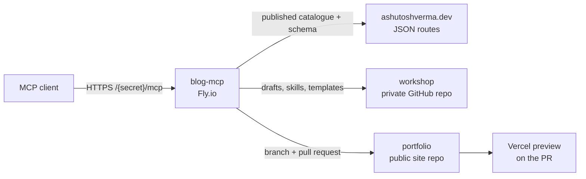
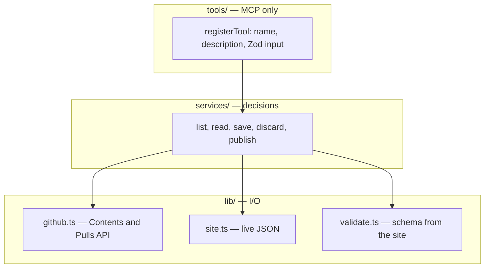

# blog-mcp

A remote MCP server for publishing to [ashutoshverma.dev](https://ashutoshverma.dev) from
any client that speaks MCP, including a phone.

Six tools move bytes. The model does the writing. The server reads content, serves
skills, saves drafts, and opens a pull request. **It never merges.** The merge button
stays with the person who owns the site.

**Status: all six tools are built, and `publish` has opened a real pull request.**
On 2026-08-03 a draft became a pull request on the public repo, publishing it twice
left exactly one, and `main` was never touched.

An idea on a train reaches a Vercel preview URL with no laptop involved. Merging the
pull request is still what makes it live.

---

## Architecture

This repo is the server and nothing else. The site and the drafts live in two other
GitHub repos. This process never clones either of them. An MCP client calls six tools
over HTTP. The server reads and writes through the GitHub API and the site's JSON
routes. Content goes live only when a person merges the pull request.

| Repo | Holds | What this server may do |
|---|---|---|
| `portfolio` (`Portfolio-new` on GitHub) | The public site and published MDX | Open a pull request. Never commit to `main` |
| `workshop` (private) | Drafts, skills, templates, the social-post archive | Read, and commit straight to `main` |
| **`blog-mcp`** (this repo) | The server | Run it |

There is no database and no checkout on disk. Every read and write is an HTTP call, so
the server cannot drift from what GitHub and the site actually have.



### How a request gets in

The process is Bun, TypeScript, and Elysia, on one small Fly.io machine that stops
when idle. The Fly app is `ashutoshverma-mcp`. The public hostname is
`mcp.ashutoshverma.dev`. Auth is an unguessable path prefix. There is one user, so
OAuth adds nothing. Clients call the server from their own cloud, which means the
process has to be public.

`createApp` in `src/index.ts` exposes three routes:

- `GET /health` returns 200 and does no I/O. Fly's liveness probe uses it.
- `GET /{secret}/health` checks the site, both GitHub repos, and `api/schema.json` in parallel. Any failure is 503 and names which layer failed.
- `POST /{secret}/mcp` is the MCP endpoint. A wrong secret matches no route and looks like any other 404.

The MCP SDK builds a fresh server per request and registers the six tools. Tool
arguments are Zod schemas. A bad argument comes back as a tool error the model can
read in the same turn.

### Layers

The call chain is `tools → services → lib`. A tool file only talks to the MCP SDK. A
service owns the decision. `lib` talks to GitHub and the site.



Services take `{ github, site }` as an argument. Tests pass a plain object.

`lib/github.ts` is `fetch` plus Zod. The domain word `portfolio` is the GitHub repo
`Portfolio-new`, and that mapping lives in one place.

### The six tools

| Tool | Reads | Writes |
|---|---|---|
| `list_content` | Published catalogue from the site's JSON, or draft slugs from `workshop` | Nothing |
| `get_content` | One draft, or one published item via `api/{kind}/{slug}` | Nothing |
| `get_skill` | A skill and its template from `workshop`, plus the voice file | Nothing |
| `save_draft` | | An MDX file on `workshop` `main` |
| `discard_draft` | | Deletes that draft |
| `publish` | The draft, plus `api/schema.json` | A branch and a pull request on `portfolio` |

A **writing** is a blog entry at `/writing/{slug}`. A **project** is a portfolio page.
A **post** is a social post and is never rendered by the site. A **slug** is fixed
once it is published. Changing a published slug needs an explicit `revise` flag.

Published content is read from the site, not from GitHub. The site's JSON routes
return metadata and the MDX body separately. Drafts are real MDX files in `workshop`.

### What `publish` does

`publish` is the only tool that touches the public repo.

1. Reject a bad slug before it becomes a path or a branch name.
2. Load the draft from `workshop` and check its metadata against the live schema at `api/schema.json`. The site owns that schema. This repo does not keep a second copy.
3. Put the file on a branch named for that kind and slug. The code never targets `main`.
4. Open a pull request, or update the existing open one. Calling publish twice on the same draft leaves one PR. A closed, unmerged PR can be recreated. A merged one is already live.

The server does not parse MDX. A broken import or a missing component shows up in the
Vercel preview build on that pull request. The token can write file contents, so a
GitHub ruleset on `portfolio` is what refuses a direct commit to `main`, together with
the rule in this code that every `portfolio` write names a branch. Nothing here calls
the merge API.

---

## Read these first

| File | What it holds |
|---|---|
| [CONTEXT.md](CONTEXT.md) | The problem, the domain words, what we are **not** building |
| [docs/adr/mcp-design.md](docs/adr/mcp-design.md) | The full design: six tools, publish gate, idempotency, and everything rejected |
| [docs/adr/001-server-runtime-and-shape.md](docs/adr/001-server-runtime-and-shape.md) | Why TypeScript on Bun and not Python |
| [CLAUDE.md](CLAUDE.md) | Agent entry point — an index to the rules |
| [tech-stack.yaml](tech-stack.yaml) | The approved dependency menu |

The rejected-alternatives table in `mcp-design.md` is the most useful page in the repo.
It is cheaper to read than to re-argue.

---

## Stack

Bun · TypeScript strict · Elysia · Zod · Biome · `bun:test` · the MCP TypeScript SDK.
Reasoning in [ADR-001](docs/adr/001-server-runtime-and-shape.md). Its original short
version — that `publish` has to parse MDX, and MDX only parses in JavaScript — no longer
holds: [ADR-005](docs/adr/005-publish-opens-a-pull-request.md) drops the MDX parse and
leaves the Vercel preview build as the check. The runtime choice stands on the rest of
ADR-001's reasoning.

No database, no accounts, no queue. Auth is an unguessable secret in the URL path — there
is exactly one user, which is the one case OAuth adds nothing to.

---

## Build order

Plumbing before anything interesting.

| Slice | Ships | State |
|---|---|---|
| 0 | Site prep: the five JSON routes, OG images | **done** — in `portfolio` |
| 1 | Skeleton, secret path, `/health`, `get_skill` only. Deployed | **done** |
| 2 | Reads: `list_content`, `get_content` | **done** |
| 3 | Cheap writes: `save_draft`, `discard_draft` | **done** |
| 4 | `publish`: validation, branch, PR, idempotency | next |
| 5 | Polish: lazy reconciliation, response nudges, client instructions | |

Slice 1 is deliberately almost nothing. The riskiest unknown in the plan is whether a
custom connector behaves properly in the mobile app, and that cannot be tested locally.
Find out with 80 lines, not after six tools exist.

---

## Working in this repo

Feature work follows [SPEC-WORKFLOW.md](SPEC-WORKFLOW.md): an accepted ADR, then a sliced
spec, then the red-green loop, one slice per PR.

```bash
bun install
bun test
bun run docs:sync    # regenerates GENERATED blocks; CI fails on drift
```

`SETUP.md` is install notes for the agent scaffold this repo started from. Safe to delete
once you stop needing them.
